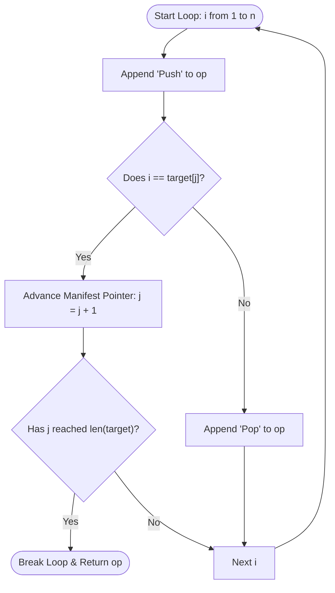

<h2><a href="https://leetcode.com/problems/build-an-array-with-stack-operations">0000. Build An Array With Stack Operations</a></h2>

<p>You are given an integer array <code>target</code> and an integer <code>n</code>.</p>

<p>You have an empty stack with the two following operations:</p>

<ul>
	<li><strong><code>"Push"</code></strong>: pushes an integer to the top of the stack.</li>
	<li><strong><code>"Pop"</code></strong>: removes the integer on the top of the stack.</li>
</ul>

<p>You also have a stream of the integers in the range <code>[1, n]</code>.</p>

<p>Use the two stack operations to make the numbers in the stack (from the bottom to the top) equal to <code>target</code>. You should follow the following rules:</p>

<ul>
	<li>If the stream of the integers is not empty, pick the next integer from the stream and push it to the top of the stack.</li>
	<li>If the stack is not empty, pop the integer at the top of the stack.</li>
	<li>If, at any moment, the elements in the stack (from the bottom to the top) are equal to <code>target</code>, do not read new integers from the stream and do not do more operations on the stack.</li>
</ul>

<p>Return <em>the stack operations needed to build </em><code>target</code> following the mentioned rules. If there are multiple valid answers, return <strong>any of them</strong>.</p>

<p>&nbsp;</p>
<p><strong class="example">Example 1:</strong></p>

<pre><strong>Input:</strong> target = [1,3], n = 3
<strong>Output:</strong> ["Push","Push","Pop","Push"]
<strong>Explanation:</strong> Initially the stack s is empty. The last element is the top of the stack.
Read 1 from the stream and push it to the stack. s = [1].
Read 2 from the stream and push it to the stack. s = [1,2].
Pop the integer on the top of the stack. s = [1].
Read 3 from the stream and push it to the stack. s = [1,3].
</pre>

<p><strong class="example">Example 2:</strong></p>

<pre><strong>Input:</strong> target = [1,2,3], n = 3
<strong>Output:</strong> ["Push","Push","Push"]
<strong>Explanation:</strong> Initially the stack s is empty. The last element is the top of the stack.
Read 1 from the stream and push it to the stack. s = [1].
Read 2 from the stream and push it to the stack. s = [1,2].
Read 3 from the stream and push it to the stack. s = [1,2,3].
</pre>

<p><strong class="example">Example 3:</strong></p>

<pre><strong>Input:</strong> target = [1,2], n = 4
<strong>Output:</strong> ["Push","Push"]
<strong>Explanation:</strong> Initially the stack s is empty. The last element is the top of the stack.
Read 1 from the stream and push it to the stack. s = [1].
Read 2 from the stream and push it to the stack. s = [1,2].
Since the stack (from the bottom to the top) is equal to target, we stop the stack operations.
The answers that read integer 3 from the stream are not accepted.
</pre>

<p>&nbsp;</p>
<p><strong>Constraints:</strong></p>

<ul>
	<li><code>1 &lt;= target.length &lt;= 100</code></li>
	<li><code>1 &lt;= n &lt;= 100</code></li>
	<li><code>1 &lt;= target[i] &lt;= n</code></li>
	<li><code>target</code> is strictly increasing.</li>
</ul>


---

# 🛍️ Build-An-Array-With-Stack-Operations | Explained

## Approach 1: Stream Simulation with Early Exit
### Intuition
Think of a conveyor belt at a sorting facility that serves packages labeled sequentially with numbers starting from $1, 2, 3, \dots, n$. You have a specific order manifest (`target`) listing only the packages you need in your truck, sorted in ascending order. 

As each package comes down the conveyor belt:
1. You **must** pick it up off the belt and load it into your staging cart (`"Push"`).
2. If this package matches the next item on your manifest, you keep it in the cart and check off that manifest entry.
3. If the package is **not** on your manifest at this stage, you immediately discard it from your cart back into a returns bin (`"Pop"`).
4. The moment all items on your manifest have been kept, you stop processing packages immediately, even if more packages are coming down the belt.

Because the incoming stream of integers is strictly increasing ($1$ to $n$) and `target` is also strictly increasing, matching elements greedily from left to right guaranteed the shortest sequence of stack operations.

### Algorithm Visualized


### Approach
1. **Initialize State:**
   - Create an empty list `op` to record stack instructions (`"Push"`, `"Pop"`).
   - Maintain a pointer `j = 0` representing the index of the next desired element in `target`.
2. **Iterate Stream from $1$ to $n$:**
   - For each number $i$ in range $[1, n]$:
     - Always record `"Push"` because the stack interface mandates reading numbers from the stream sequentially.
     - **Match found ($i == target[j]$):** Increment pointer $j$ to look for the next target element. If $j == \text{len}(target)$, every required element has been stacked; break early to avoid processing unneeded numbers.
     - **Mismatch ($i \neq target[j]$):** The current number is unwanted. Record `"Pop"` to immediately remove it from the stack.
3. **Return:** Return the list `op`.

### Detailed Code Analysis
- **Lines 3–4 (`op = []`, `j = 0`):**
  - `op` stores the sequence of output string operations.
  - `j` tracks our current index in `target`.
- **Line 6 (`for i in range(1, n + 1):`):**
  - Iterates sequentially through stream values from $1$ up to $n$ inclusive.
- **Line 7 (`op.append("Push")`):**
  - Every integer $i$ from the stream must enter the stack first before any discard decisions can be made. *(Note: in pure Python, `"Push"` must be a string literal rather than an undefined variable identifier `Push`)*.
- **Lines 9–12 (`if i == target[j]: ... break`):**
  - Checks if the stream item $i$ matches the expected item `target[j]`.
  - If it matches, $j$ is advanced (`j = j + 1`).
  - Immediately verifies `if j == len(target): break`. This early termination is a crucial optimization: once all target elements are accumulated, any subsequent stream elements up to $n$ are ignored entirely.
- **Lines 14–15 (`else: op.append("Pop")`):**
  - If $i \neq target[j]$, the item is redundant. An immediate `"Pop"` leaves the stack in the exact state it was in before $i$ was pushed.
- **Line 18 (`return op`):**
  - Returns the collected list of operations.

### Code
```python
class Solution:
    def buildArray(self, target: list[int], n: int) -> list[str]:
        op = []
        j = 0

        for i in range(1, n + 1):
            op.append("Push")

            if i == target[j]:
                j = j + 1
                if j == len(target):
                    break            
            else:
                op.append("Pop")
                
        return op
```

### Complexity
- **Time Complexity:** $\mathcal{O}(M)$, where $M = \text{target}[-1]$ (the maximum value present in `target`).
  - The loop runs at most $\text{target}[-1]$ times due to the early break condition (`j == len(target)`).
  - Since $\text{target}[-1] \le n$, the worst-case time is bounded by $\mathcal{O}(\min(n, \text{target}[-1])) = \mathcal{O}(\text{target}[-1])$.
  - Each iteration performs $\mathcal{O}(1)$ list appends and condition checks.
- **Space Complexity:** $\mathcal{O}(1)$ auxiliary space.
  - Excluding the output list `op` (which takes up to $\mathcal{O}(\text{target}[-1])$ space depending on how many intermediate pops occur), the algorithm only maintains two scalar integer variables ($i$ and $j$).

---

## 🕵️‍♂️ Follow-up Questions (Optional)

1. **Can we eliminate the loop over the range $1$ to $n$ completely and iterate directly over `target`?**
   - **Answer:** Yes. Instead of checking every number $1, 2, \dots, \text{target}[-1]$, we can iterate through `target` and calculate the difference between the current target value and the previous target value. If the gap between two consecutive targets is $k$, we can append `"Push", "Pop"` $k - 1$ times, followed by a single `"Push"`. This changes the loop iterations from $\mathcal{O}(\text{target}[-1])$ to $\mathcal{O}(|target|)$.

2. **What if the target array was not guaranteed to be strictly increasing?**
   - **Answer:** The problem would become a general stack-permutation verification problem (similar to *LeetCode 946: Validate Stack Sequences*). We would need an explicit stack data structure to simulate pushes and pops, as numbers would no longer appear in monotonically increasing order.